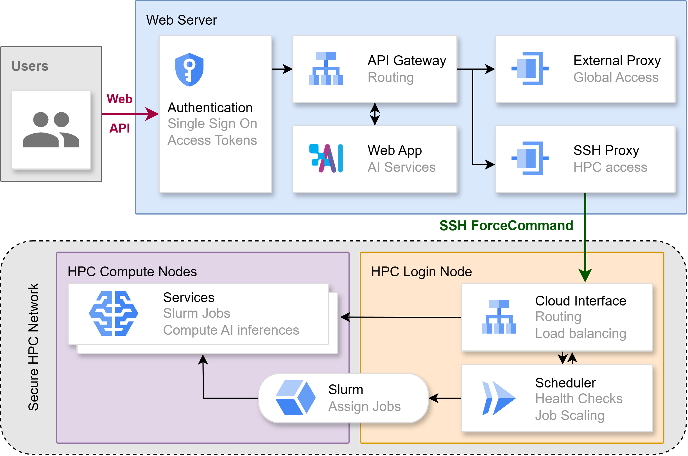
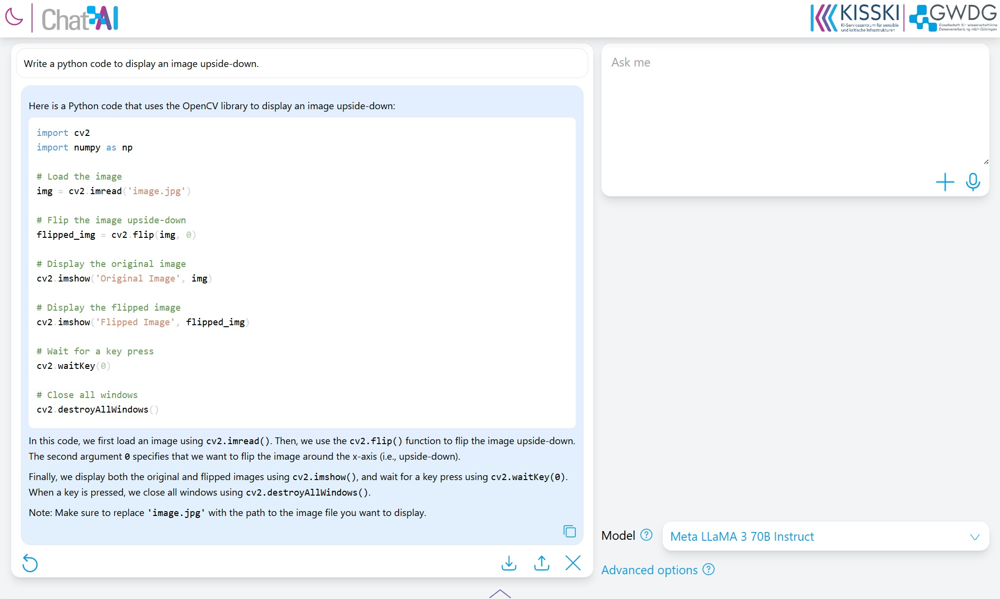

<p align="center">
  <picture>
    
  </picture>
</p>

<h3 align="center">
A Seamless Slurm-Native Solution for HPC-Based Services
</h3>

<p align="center">
<a href="https://docs.hpc.gwdg.de/services/chat-ai"><b>Documentation</b></a> | <a href="https://doi.org/10.1007/s11227-026-08508-3"><b>Paper</b></a>
</p>

This repository contains the stand-alone web interface of Chat AI. The implementation of the remaining components of the complete architecture can be found in two other repos:
- Server components, incl. API gateway and SSH proxy: https://github.com/gwdg/saia-hub 
- HPC components, incl. scheduler and slurm scripts: https://github.com/gwdg/saia-hpc

<p align="center">

</p>

Together these repos provide the entire underyling mechanism for Chat AI, which can be generalized as a slurm-native HPC web service.

<p align="center">

</p>

## Quick Installation Guide

Note that Chat AI's web interface provided in this repository can be set up on any device independently from the rest of the architecture, to act solely as a wrapper for an OpenAI-compatible API endpoint.

1. Ensure that Docker is installed. Follow the [guides](https://docs.docker.com/engine/install/) to install Docker on your operating system. 
    ```bash
    docker --version
    ```

2. Clone this repository and navigate to the root folder.
    ```bash
    git clone https://github.com/gwdg/chat-ai
    cd chat-ai
    ```

3. In the `secrets` directory, rename `front.json.sample` to `front.json` and `back.json.sample` to `back.json`, and configure them accordingly. For a local installation with a valid Chat AI API key, you only need to replace the value of `apiKey` in `back.json`:
    ```bash
    {
      "port": 8081,
      "apiEndpoint": "https://chat-ai.academiccloud.de/v1",
      "apiKey": "<your_chat_ai_api_key>",
      "serviceName": "Custom Chat AI"
    }
    ```

4. Run the components using `docker-compose`:
    ```bash
    docker compose up
    ```

5. Open your browser and navigate to `http://localhost:8080/`, or whichever path and port number you have configured.

## Getting Started

The web interface consists of two Docker containers, `front` and `back`. The `front` service is a ReactJS app served by ViteJS and runs entirely on the client's browser. The `back` service is simply a wrapper for message requests which gives the developer more control over the requests and prevents CORS errors on the user's browser.  

Make sure you have docker installed and docker compose.

For Ubuntu 24.04, install docker compose with:
```bash
aptitude install docker-compose-v2
```

To build the images, run:

```bash
docker compose build front
docker compose build back
```

To start either of the two components, run:
```bash
docker compose up front -d
docker compose up back -d
```

You should then be able to access the web interface via the path and port number specified in the config file.

-----
To apply any changes in the configuration and/or source code, run:
```bash
docker compose restart front
docker compose restart back
```

Note that in some cases rebuilding the docker image might be necessary.

In `build` mode the container runs the build and exits, so `docker compose restart front` (or `docker compose up front`) runs it again and picks up the new `front.json`. The result is a snapshot, though: if you copied `front/dist` to a web root, copy the new files again (see [Serving a Static Build](#serving-a-static-build-apache--nginx)).

## Configuration

You can set the port numbers for both the `front` and `back` services in the `front.json` and `back.json` files.

The `front` service uses the following configurable attributes in `front.json`:
- `mode`: `dev` runs the Vite development server, `prod` builds and serves the app with `vite preview`, and `build` only creates the static bundle for you to serve with your own web server (see [Serving a Static Build](#serving-a-static-build-apache--nginx)).
- `port`: Port number to listen on in `dev` and `prod` mode. Default: 8080. Ignored in `build` mode.
- `backendPath`: Path to `back` service, used for sending messages and processing PDF files, e.g. `http://localhost:8081/` or `/backend`
- `modelsPath`: Path to get list of available models from. Simply set to `<backendPath>/models` if unsure
- `userDataPath`: (Optional) Path to get user data. Simply set to `<backendPath>/user` if unsure
- `default`: Default settings for new conversations, including default `model` with `model.id` and `model.name`, as well as `top_p` and `temperature`.
- `titleGenerationModel`: Model ID for title generation
- `memoryGenerationModel`: Model ID for memory generation and updates
- `announcement`: Text to be displayed in the announcement bar at the top of the window

The `back` service listens to requests from `front` and interacts with an OpenAI-compatible API endpoint to produce responses. It uses the following configurable attributes in `back.json`:
- `port`: Port number to listen on. Default: 8081
- `apiEndpoint`: Endpoint of your API provider. If you have a Chat AI API key, set this to `https://chat-ai.academiccloud.de/v1`
- `apiKey`: Your valid API key
- `serviceName`: (Optional) A custom service name to be sent as a header in API requests to your provider. Will not be visible in the interface

If you wish to avoid using different ports for the `front` and `back` services, you must set up a reverse proxy or virtual host to route paths such as `/models` and `/backend` to the backend service listening on its own distinguished port. This can be done with popular server software such as Apache or Nginx.

If you wish to customize the list of available models, you must create a path that returns an OpenAI-style JSON response containing the model ids and names, and set the `modelsPath` in `front.json` accordingly. If configured correctly, your custom list will be displayed in the dropdown menu in the interface, instead of the list from your API provider.

## Serving a Static Build (Apache / Nginx)

Setting `"mode": "build"` in `secrets/front.json` makes the front container run `npm run build` (`vite build`) instead of starting a server. Because `docker-compose.yml` mounts `./front` into the container, the generated bundle is written to `front/dist/` on the host:

```bash
# set "mode": "build" in secrets/front.json first
docker compose up front      # runs the build, then the container exits
ls front/dist                # index.html, assets/, chat-ai.ico, ...
```

Use `docker compose logs -f front` if you started it detached; the build output and any errors are in that log. A failed build exits non-zero, and `restart: on-failure` makes Compose retry it, so fix the error before rerunning.

The container exiting is expected: in this mode nothing is served by Docker. Copy the contents of `front/dist/` into your web server's document root — the examples below assume Debian/Ubuntu's default `/var/www/html`:

```bash
sudo cp -a front/dist/. /var/www/html/
```

The directory that contains `index.html` is the one to use both as the document root and in the `<Directory>` blocks. If you prefer to serve `front/dist` in place, substitute its absolute path for `/var/www/html` everywhere below. `front/dist` is gitignored, so never commit it.

Without Docker, the same bundle comes from `cd front && npm i && npm run build`, run from `front/` so the default `CONFIG_LOCATION=../secrets/front.json` resolves (or set `CONFIG_LOCATION` explicitly).

Two things matter when serving it:

- Every `VITE_*` value — including `backendPath`, `modelsPath` and `userDataPath` — is compiled into the JavaScript during the build, so `front/dist` is a snapshot. After changing `front.json`, rerun the build (`docker compose up front` or `docker compose restart front` both re-run the entrypoint) and redeploy the new files; editing the config does not change an already-built or already-copied bundle.
- The app uses client-side routing (`/chat/<id>`, `/landing`, ...) and Vite's `base` is `"/"`. Unknown paths must fall back to `index.html`, and the bundle must be served from the domain root. For a sub-path deployment, change `base` in `front/vite.config.js` and rebuild.

To keep the browser on a single origin, proxy the `back` service under the same host. With such a setup, the relevant parts of `front.json` are:

```json
"backendPath": "/backend",
"modelsPath": "/backend/models",
"userDataPath": "/backend/user",
```

Nginx:

```nginx
server {
    listen 80;
    server_name chat.example.org;

    root /var/www/html;
    index index.html;

    # Attachments are capped at 50 MB by the back service.
    client_max_body_size 50m;

    # Vite fingerprints these file names, so they can be cached forever.
    location /assets/ {
        try_files $uri =404;
        add_header Cache-Control "public, max-age=31536000, immutable";
    }

    # Client-side routes fall back to the SPA shell.
    location / {
        try_files $uri /index.html;
        add_header Cache-Control "no-cache";
    }

    # /backend/... -> http://127.0.0.1:8081/... (trailing slash strips the prefix)
    location /backend/ {
        proxy_pass http://127.0.0.1:8081/;
        proxy_http_version 1.1;
        proxy_set_header Host $host;
        proxy_set_header X-Real-IP $remote_addr;
        proxy_set_header X-Forwarded-For $proxy_add_x_forwarded_for;
        proxy_set_header X-Forwarded-Proto $scheme;
        proxy_buffering off;          # stream chat responses token by token
        proxy_read_timeout 3600s;
    }
}
```

Apache (enable the modules with `a2enmod headers proxy proxy_http`):

```apache
<VirtualHost *:80>
    ServerName chat.example.org
    DocumentRoot /var/www/html

    <Directory /var/www/html>
        Options -Indexes +FollowSymLinks
        AllowOverride None
        Require all granted
        FallbackResource /index.html
    </Directory>

    # Missing hashed assets must 404 instead of returning the SPA shell.
    <Directory /var/www/html/assets>
        FallbackResource disabled
        Header set Cache-Control "public, max-age=31536000, immutable"
    </Directory>

    <FilesMatch "index\.html$">
        Header set Cache-Control "no-cache"
    </FilesMatch>

    ProxyPreserveHost On
    ProxyPass        /backend/ http://127.0.0.1:8081/
    ProxyPassReverse /backend/ http://127.0.0.1:8081/

    # Stream chat responses instead of buffering them.
    <Location /backend/>
        ProxySet flushpackets=on
    </Location>
</VirtualHost>
```

Proxying is optional: `backendPath` can also be an absolute URL such as `http://api.example.org:8081`. The `back` service enables CORS, so the browser can call it cross-origin.
### Model metadata and the model selector

The interface has two model-selector variants and picks one automatically from the `/models` response:

- **Extended selector** — used for SAIA / Chat AI, whose `/models` response includes extra metadata beyond the OpenAI defaults. It offers search, sorting, list/extended/grid views, and groups models into folders by the first word of their name. The `description` field is shown for each model; `releaseDate`, `company`, `contextLength`, and `external` are also displayed, and name, release date, parameter count, and context length can be used for sorting.
- **Simple selector** — used for a plain OpenAI-compatible API that only returns the standard model fields. It offers search and the same folder grouping, but no extended metadata or view modes.

The variant is chosen from the `description` field of the **first** model in the response. If you provide a custom `modelsPath` and want the extended selector, include a `description` in each entry (plus any of the optional fields above that you want to display). A model's `name` falls back to its `id` when omitted.

## Development
You can use docker as local development setup. Alternatively, you can run Chat AI directly for which you nee `nodejs` installed.

To start the backend, run:
```bash
cd back
# install dependencies
npm i
# then run with
npm run start
```

Similarly, for the frontend:
```bash
cd front
# install dependencies
npm i
# then run with
npm run dev
```

[See CONTRIBUTING.md](CONTRIBUTING.md) for how to contribute to this project.

## Acknowledgements
We thank all contributors for the design and implementation of the web interface.

We thank the Chat AI community, and all colleagues and partners involved in this project.

## Citation

If you use Chat AI or SAIA in your research or services, please cite us as follows:

```
@article{doosthosseini_saia_2026,
	title = {{SAIA}: a seamless {Slurm}-native solution for {HPC}-based services},
	volume = {82},
	issn = {1573-0484},
	url = {https://doi.org/10.1007/s11227-026-08508-3},
	doi = {10.1007/s11227-026-08508-3},
	number = {7},
	journal = {The Journal of Supercomputing},
	author = {Doosthosseini, Ali and Decker, Jonathan and Nolte, Hendrik and Kunkel, Julian},
	month = may,
	year = {2026},
	pages = {403},
}
```
