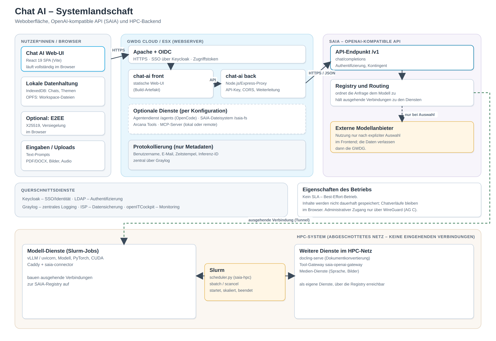
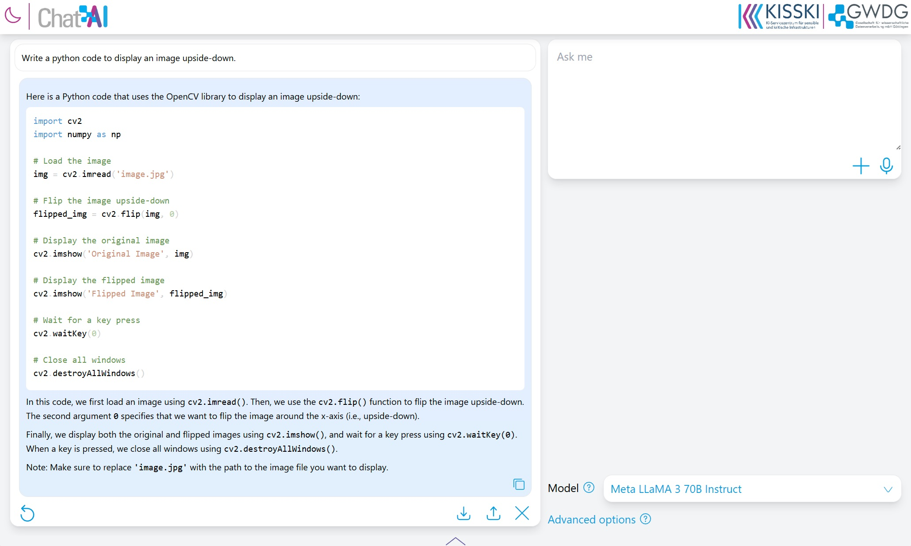

<p align="center">
  <picture>
    
  </picture>
</p>

<h3 align="center">
A Seamless Slurm-Native Solution for HPC-Based Services
</h3>

<p align="center">
<a href="https://docs.hpc.gwdg.de/services/chat-ai"><b>Documentation</b></a> | <a href="https://doi.org/10.1007/s11227-026-08508-3"><b>Paper</b></a>
</p>

This repository contains the stand-alone web interface of Chat AI. The implementation of the remaining components of the complete architecture can be found in two other repos:
- Server components, incl. API gateway and SSH proxy: https://github.com/gwdg/saia-hub 
- HPC components, incl. scheduler and slurm scripts: https://github.com/gwdg/saia-hpc

<p align="center">

</p>

Together these repos provide the entire underyling mechanism for Chat AI, which can be generalized as a slurm-native HPC web service.

<p align="center">

</p>

## Quick Installation Guide

Note that Chat AI's web interface provided in this repository can be set up on any device independently from the rest of the architecture, to act solely as a wrapper for an OpenAI-compatible API endpoint.

1. Ensure that Docker is installed. Follow the [guides](https://docs.docker.com/engine/install/) to install Docker on your operating system. 
    ```bash
    docker --version
    ```

2. Clone this repository and navigate to the root folder.
    ```bash
    git clone https://github.com/gwdg/chat-ai
    cd chat-ai
    ```

3. In the `secrets` directory, rename `front.json.sample` to `front.json` and `back.json.sample` to `back.json`, and configure them accordingly. For a local installation with a valid Chat AI API key, you only need to replace the value of `apiKey` in `back.json`:
    ```bash
    {
      "port": 8081,
      "apiEndpoint": "https://chat-ai.academiccloud.de/v1",
      "apiKey": "<your_chat_ai_api_key>",
      "serviceName": "Custom Chat AI"
    }
    ```

4. Run the components using `docker-compose`:
    ```bash
    docker compose up
    ```

5. Open your browser and navigate to `http://localhost:8080/`, or whichever path and port number you have configured.

## Getting Started

The web interface consists of two Docker containers, `front` and `back`. The `front` service is a ReactJS app served by ViteJS and runs entirely on the client's browser. The `back` service is simply a wrapper for message requests which gives the developer more control over the requests and prevents CORS errors on the user's browser.  

Make sure you have docker installed and docker compose.

For Ubuntu 24.04, install docker compose with:
```bash
aptitude install docker-compose-v2
```

To build the images, run:

```bash
docker compose build front
docker compose build back
```

To start either of the two components, run:
```bash
docker compose up front -d
docker compose up back -d
```

You should then be able to access the web interface via the path and port number specified in the config file.

-----
To apply any changes in the configuration and/or source code, run:
```bash
docker compose restart front
docker compose restart back
```

Note that in some cases rebuilding the docker image might be necessary.

In `build` mode the container runs the build and exits, so `docker compose restart front` (or `docker compose up front`) runs it again and picks up the new `front.json`. The result is a snapshot, though: if you copied `front/dist` to a web root, copy the new files again (see [Serving a Static Build](#serving-a-static-build-apache--nginx)).

## Workspace import manifests

A public Git repository can bootstrap a workspace. See
[docs/workspace-manifests.md](docs/workspace-manifests.md) for the
`chat-ai-manifest.json` schema and confirmation flow. An example repository is
prepared under `remote-example/`.

## End-to-end encryption

Chat AI can seal the traffic of individual models in the browser. In
**User settings → Encryption**, import the public key of an encryption-capable
model (paste it, choose a `.pub` file, load a single key from a URL, or import a
key directory) and enter the models it applies to as a comma-separated list of
ids or names. The key is tested against those models with a real sealed request
before it is saved; a key the node does not accept is not stored. The model list
in the tab is read-only and only shows models bound to a key plus models that
internal features use in the background (titles, memory, proposals, conversation
summaries, image analysis), labelled with the feature. Rows report whether the
model is encrypted, blocked by a missing/invalid key, or stays in cleartext; to
change a model's binding, remove the key and import it again. The OpenCode agent
picks its model per session and is not covered by model keys. A bound model shows a green lock
wherever it is listed, and every `/chat/completions` request it sends leaves the
browser as ciphertext; the node seals its answer the same way.

- Keys are **public** X25519 material and may be imported from a trusted source.
  They are stored with your user settings, not in `secrets/`.
- Only `/chat/completions` is encrypted. Document conversion, speech, image and
  web-search endpoints stay cleartext.
- If a bound key is missing or invalid, the request is **blocked** instead of
  sent in cleartext.

The protocol is the v3 protocol of `saia/saia-e2ee`; the browser port lives in
`front/src/e2ee/` and `back/service.mjs` forwards a sealed envelope untouched.

## Configuration

You can set the port numbers for both the `front` and `back` services in the `front.json` and `back.json` files.

The `front` service uses the following configurable attributes in `front.json`:
- `mode`: `dev` runs the Vite development server, `prod` builds and serves the app with `vite preview`, and `build` only creates the static bundle for you to serve with your own web server (see [Serving a Static Build](#serving-a-static-build-apache--nginx)).
- `port`: Port number to listen on in `dev` and `prod` mode. Default: 8080. Ignored in `build` mode.
- `backendPath`: Path to `back` service, used for sending messages and processing PDF files, e.g. `http://localhost:8081/` or `/backend`
- `modelsPath`: Path to get list of available models from. Simply set to `<backendPath>/models` if unsure
- `userDataPath`: (Optional) Path to get user data. Simply set to `<backendPath>/user` if unsure
- `apiKey`: (Optional) Bearer token sent to `backendPath`, `modelsPath` and `userDataPath`. Leave it out when the OIDC proxy authenticates the user, as in the default setup. It exists for endpoints that the browser may call directly, such as a SAIA engine (see [Calling a SAIA Engine Directly](#calling-a-saia-engine-directly-local-testing)). Vite compiles it into the bundle, so treat it as public
- `fakeAuthHeaders`: (Optional) Object of extra headers sent with direct API calls (`backendPath`, `modelsPath`, `userDataPath`, chat, files, speech). It exists for a direct SAIA engine whose Chat AI compatibility routes under `/assumes_behind_oidc` expect the `oidc_claim_*` headers that Apache/`auth_openidc` normally adds. Setting it makes the browser impersonate that identity, so only use it against a local or test engine whose protected routes are not otherwise reachable; never set it in a deployment. The values are compiled into the bundle
- `opencodeServerUrl` / `opencodeServerUsername` / `opencodeServerPassword`: (Optional) Defaults for a direct OpenCode server connection. A direct connection is only offered when Chat AI itself is opened from `localhost`/`127.0.0.1`; everywhere else agents run through the SAIA agent service, which lives in its own repository, at `/agents` on the app's own origin, and a direct agent cannot be created (an existing one is migrated when saved). These defaults are then used only for that local access and for the container's own credentials. The agent service needs no URL in `front.json`: the SAIA gateway routes `/agents/*` to it. A dev server has no gateway, so it forwards `/agents` only when `AGENT_SERVICE_DEV_PROXY` names a service, for example `AGENT_SERVICE_DEV_PROXY=http://127.0.0.1:8090 npm run dev`; there is no default port
- `agentServiceMode`: (Optional) How the browser reaches the SAIA agent service. Leave it out to call `/agents` on the app's own origin, which needs a gateway that routes that path; `"tunnel"` carries every `/agents` call inside a `saia-agent` chat completion instead, for a deployment whose gateway forwards only model traffic (see [Reaching the Agent Service When Only the Model Is Exposed](#reaching-the-agent-service-when-only-the-model-is-exposed))
- `agentServiceModel`: (Optional) Model id that carries a tunnelled call. Default: `saia-agent`
- `default`: Default settings for new conversations, including default `model` with `model.id` and `model.name`, as well as `top_p` and `temperature`.
- `titleGenerationModel`: Model ID for title generation
- `memoryGenerationModel`: Model ID for memory generation and updates
- `e2eeKeyUrl`: (Optional) Base URL of the directory that publishes the E2EE model node keys as `<MODELNAME>.pub` plus a `keys.json` manifest that binds every key to its model. The Encryption tab prefills it and loads every published key from it after verification (the Directory tab prefills `<e2eeKeyUrl>keys.json` and can also read a local folder of `.pub` files). Default: `https://docs.ai.gwdg.de/technical/saia-platform/keys/`. Generate the pairs and `keys.json` with `make -C encryption keys` or `node encryption/generate-model-keys.mjs` (see [encryption/README.md](encryption/README.md))
- `announcement`: Text to be displayed in the announcement bar at the top of the window
- `useOpenAISdk`: (Optional) `true` sends chat requests through the official `openai` SDK instead of the built-in lightweight `fetch` client. The SDK is then loaded on first use. Default: `false`

The `back` service listens to requests from `front` and interacts with an OpenAI-compatible API endpoint to produce responses. It uses the following configurable attributes in `back.json`:
- `port`: Port number to listen on. Default: 8081
- `apiEndpoint`: Endpoint of your API provider. If you have a Chat AI API key, set this to `https://chat-ai.academiccloud.de/v1`
- `apiKey`: Your valid API key
- `serviceName`: (Optional) A custom service name to be sent as a header in API requests to your provider. Will not be visible in the interface
- `remoteFilesEndpoint`: (Optional) Base URL of the saia-rag-web API used by Arcana Tools and Remote file access. Default: `http://localhost:8000/arcanas/api/v1`
- `remoteFilesArcana`: (Optional) Arcana name that stores generic remote files. It is created on first write. Default: `remote-files`

If you wish to avoid using different ports for the `front` and `back` services, you must set up a reverse proxy or virtual host to route paths such as `/models` and `/backend` to the backend service listening on its own distinguished port. This can be done with popular server software such as Apache or Nginx.

If you wish to customize the list of available models, you must create a path that returns an OpenAI-style JSON response containing the model ids and names, and set the `modelsPath` in `front.json` accordingly. If configured correctly, your custom list will be displayed in the dropdown menu in the interface, instead of the list from your API provider.

## Calling a SAIA Engine Directly (local testing)

`back` is a thin proxy: it adds the API key server-side and avoids CORS. A SAIA engine exposes the same OpenAI-compatible routes under `/public/v1` with CORS enabled and accepts `Authorization: Bearer <key>`, so `front` can call it without `back`. That is what `secrets/front-local-conf.json` does for the `saia/saia-engine/local-testing` stack, which lives in the SAIA engine repository:

```json
"backendPath": "http://localhost:10000/public/v1",
"modelsPath": "http://localhost:10000/public/v1/models",
"userDataPath": "/assumes_behind_oidc/user",
"apiKey": "35c1e0a9f8d24b6f9c0a1e2d3f4a5b6c",
"fakeAuthHeaders": {
  "oidc_claim_goe_id": "local-fake-1",
  "oidc_claim_uid": "local-fake",
  "oidc_claim_o": "GWD",
  "oidc_claim_ou": "GWDG",
  "oidc_claim_email": "local-fake@example.org",
  "oidc_claim_given_name": "Sample",
  "oidc_claim_family_name": "User"
}
```

`/assumes_behind_oidc` is the engine's Chat AI compatibility app, the `back` replacement (`chat_ai_ui_back.py`). It expects the `oidc_claim_*` headers that Apache/`auth_openidc` injects, so `fakeAuthHeaders` supplies them. The dev and preview servers proxy that path to the origin of `backendPath`, which keeps the call same-origin; a static build needs the same route from your web server, and a deployment already routes it through Apache. The first request creates an engine user from the claims; the seeded `tester` is a LOCAL account without a `goe_id`, so a different uid is used. The profile tab then shows this identity. It has none of `tester`'s model grants, which does not matter here because chat and models still use `/public/v1` with the API key. `fakeAuthHeaders` is test-only: it lets the browser impersonate an OIDC user, so never set it when the engine's protected routes are reachable in production.

Start the local stack, then run `front` with that config file:

```bash
docker compose -f saia/saia-engine/local-testing/compose.yml up -d --build
cd front && CONFIG_LOCATION=../secrets/front-local-conf.json npm run dev
```

The file ships with the local test settings: the fixed dev key from the stack's `.env.example`, `bridge/deepseek-v4.1-flash-1017` as the default and title/memory/proposal model, the fake OIDC claims for the profile, and all UI modules switched on. That id is a real GWDG model reached through the bridge, so it needs `GWDG_ENABLED=true` and a valid `GWDG_API_KEY` in `local-testing/.env`, and its public id is `bridge/` + the GWDG id. Without a GWDG key the stack lists only the local mocks (`bridge/local-echo-1`, `bridge/local-slow-1`), which answer every prompt with `local-echo-1 says: …`; point the four model entries at a model the selector actually lists then. The browser only ever calls the agent service at `/agents` on the app's own origin, so to use one from the dev server start it with `AGENT_SERVICE_DEV_PROXY` pointing at it (for example `AGENT_SERVICE_DEV_PROXY=http://127.0.0.1:8090 CONFIG_LOCATION=../secrets/front-local-conf.json npm run dev`); without that variable the path stays same-origin and there is no service behind it. `back`-only features — MCP, Arcana Tools and the OpenCode bridge on `/bridge/*` — still have no route in this mode, and document conversion still needs the engine's docling-serve backend (the browser-side conversion in Chat preferences works without it). The agent bridge does work with a service-managed agent from the SAIA agent service, which lives in its own repository: it uses `/agents/<id>/bridge` on the app origin, which the dev server proxies when `AGENT_SERVICE_DEV_PROXY` is set. For a direct (non-service) agent the workspace popover reports "Agent bridge not available" with the 404 from `<backendPath>/bridge/sessions` instead of a broken bridge, and its access switch is disabled.

The Agents sidebar is wired to the agent service, not to a fixed `opencodeServerUrl`. The browser always calls it at `/agents` on the app's own origin. A deployment relies on the SAIA gateway routing `/agents/*` to the service; the Vite dev server has no gateway, so it forwards that path only when `AGENT_SERVICE_DEV_PROXY` names the service (there is no default port). Start it before adding an agent:

```bash
cd agent-service
cp backends.example.yml backends.yml   # enable a docker or process OpenCode backend
make start                             # venv + install + schema + service on :8090
```

With the bundled dummy backend the UI works but the agent has no tools; a `kind: docker` entry starts the real `gwdg-opencode` container per agent (it needs access to the Docker daemon). The add-agent window defaults to the service and offers a toggle back to a direct OpenCode server.

The stack runs no TTS or transcription service (`kokoro-82m` / `whisperx`), so engine-backed speech cannot work there. Set `"speech": "browser"` instead of a `{"model", "voice"}` object: that turns speech on and speaks through the browser's own voices, without calling the engine. (The legacy `"speech": true` is still accepted.) Voice **input** still goes through the selected chat model, so it needs a model that accepts audio (for example `bridge/qwen3-omni-30b-a3b-instruct` in a stack federating GWDG).

Two things to keep in mind: the key is compiled into the bundle, so this is a local development setup, not a deployment pattern, and the engine's `/public/v1` routes are rate-limited per key just like any other client. The modules are enabled in this file: the browser agent (`modules.agent`) works against a direct endpoint because it sends `apiKey` as its bearer token, and the Agents sidebar uses the same-origin `/agents` path, which the dev server forwards when `AGENT_SERVICE_DEV_PROXY` is set; MCP and Arcana Tools remain `back`-only routes. The agent bridge is served by the agent service for a service-managed agent, and only a direct (non-service) agent still needs `back` for it.

### Minimal deployment on the same engine

The `minimal` deployment is a separate front config, not a separate app, so it can use the same direct-engine setup. The local `secrets/front-minimal.json` (gitignored, so the key stays out of the repo) points at the local stack:

```json
{
  "mode": "dev",
  "deployment": "minimal",
  "port": 8083,
  "backendPath": "http://localhost:10000/public/v1",
  "modelsPath": "http://localhost:10000/public/v1/models",
  "userDataPath": "/assumes_behind_oidc/user",
  "apiKey": "35c1e0a9f8d24b6f9c0a1e2d3f4a5b6c",
  "fakeAuthHeaders": {
    "oidc_claim_goe_id": "local-fake-minimal",
    "oidc_claim_uid": "local-fake-minimal",
    "oidc_claim_o": "GWD",
    "oidc_claim_ou": "GWDG",
    "oidc_claim_email": "local-fake-minimal@example.org",
    "oidc_claim_given_name": "Minimal",
    "oidc_claim_family_name": "User"
  },
  "titleGenerationModel": "bridge/qwen3-30b-a3b-instruct-2507",
  "memoryGenerationModel": "bridge/qwen3-30b-a3b-instruct-2507",
  "proposalGenerationModel": "bridge/qwen3-30b-a3b-instruct-2507",
  "default": {
    "model": {
      "id": "bridge/qwen3-30b-a3b-instruct-2507",
      "name": "Qwen 3 30B A3B Instruct (local SAIA engine)"
    }
  }
}
```

`deployment: "minimal"` turns off every module and every feature except the Meta chat; the rest of the file is what `front-local-conf.json` does for the full UI. `CONFIG_LOCATION=../secrets/front-minimal.json npm run dev` then serves it on `:8083` without `back`. The model id must exist in the stack's `/public/v1/models`; without GWDG federation that is `bridge/local-echo-1` / `bridge/local-slow-1`. `secrets/front-minimal.json.sample` remains the portable variant that expects `back` on `:8081`.

## Reaching the Agent Service When Only the Model Is Exposed

A SAIA deployment normally routes `/agents/*` to the agent service. Some gateways
forward only model traffic: they accept `POST …/chat/completions` for the
`saia-agent` model and have no path rule for the service's own routes. Add

```json
{ "agentServiceMode": "tunnel" }
```

to `front.json` for that case (`agentServiceModel` overrides the model id, default
`saia-agent`). Every `/agents` call is then sent as an ordinary completion that
carries the real request in one body field:

```json
{
  "model": "saia-agent",
  "messages": [],
  "chat_ai_http": { "method": "GET", "path": "/agents", "body": null }
}
```

The target cannot travel in a header or a query string: the engine rebuilds the
upstream request from `content-type` and the body, so everything else is dropped
on that hop. The agent service re-enters its own ASGI app with the carried
request, runs it as the caller the completion was already resolved to (so the
usual `inference-id` identity setup applies unchanged), and answers with the
real status and body boxed under `chat_ai_http`. A streaming target
(`/agents/<id>/opencode/api/event`) sends its bytes as base64 deltas, which the
front end decodes back into the same SSE the OpenCode client always parsed. Both
levels have to say `stream: true`: inside `chat_ai_http` so the service answers
with SSE, and at the top level so the engine relays those bytes instead of
collecting them and trying to parse the body as one JSON object.

The workspace bridge works in this mode: the browser leg becomes a long poll
(`GET …/bridge/poll/<id>`, `POST …/bridge/reply/<id>`), and the agent side is a
stdio MCP sidecar that the agent service names in the session response
(`sidecarCommand`) and OpenCode spawns locally, so it dials the service directly
and never needs the tunnel. [docs/agent-bridge-mcp.md](docs/agent-bridge-mcp.md)
has the address rules and the failure a wrong agent address used to produce.

One limit remains:

- **A stream ends with the engine's read timeout** (600 s), because the
  completion it rides on does too. An idle OpenCode event stream reconnects for
  the next window; a prompt that runs longer than that window is cut off.

Only `/agents` is reachable this way; a carried `/v1` request is refused so a
completion cannot call itself. Without the mode the browser keeps calling
`/agents` on the app's own origin.

`front-local-conf.json` sets the mode, because the local test stack has no
`/agents` route either: with `AGENT_SERVICE_DEV_PROXY` unset, the Agents sidebar
reaches the service through the engine's model endpoint instead of a dev proxy.

## Serving a Static Build (Apache / Nginx)

Setting `"mode": "build"` in `secrets/front.json` makes the front container run `npm run build` (`vite build`) instead of starting a server. Because `docker-compose.yml` mounts `./front` into the container, the generated bundle is written to `front/dist/` on the host:

```bash
# set "mode": "build" in secrets/front.json first
docker compose up front      # runs the build, then the container exits
ls front/dist                # index.html, assets/, chat-ai.ico, ...
```

Use `docker compose logs -f front` if you started it detached; the build output and any errors are in that log. A failed build exits non-zero, and `restart: on-failure` makes Compose retry it, so fix the error before rerunning.

The container exiting is expected: in this mode nothing is served by Docker. Copy the contents of `front/dist/` into your web server's document root — the examples below assume Debian/Ubuntu's default `/var/www/html`:

```bash
sudo cp -a front/dist/. /var/www/html/
```

The directory that contains `index.html` is the one to use both as the document root and in the `<Directory>` blocks. If you prefer to serve `front/dist` in place, substitute its absolute path for `/var/www/html` everywhere below. `front/dist` is gitignored, so never commit it.

Without Docker, the same bundle comes from `cd front && npm i && npm run build`, run from `front/` so the default `CONFIG_LOCATION=../secrets/front.json` resolves (or set `CONFIG_LOCATION` explicitly).

Two things matter when serving it:

- Every `VITE_*` value — including `backendPath`, `modelsPath` and `userDataPath` — is compiled into the JavaScript during the build, so `front/dist` is a snapshot. After changing `front.json`, rerun the build (`docker compose up front` or `docker compose restart front` both re-run the entrypoint) and redeploy the new files; editing the config does not change an already-built or already-copied bundle.
- The build writes a Brotli (`.br`) and gzip (`.gz`) copy next to every compressible file, including the large Typst WASM files. Let the web server send those instead of compressing on every request (see the examples below). `vite preview` (`"mode": "prod"`) already does this.
- The build also emits `sw.js`, a service worker that keeps the hashed `assets/` files and the vendored `typst-assets/` and `tikzjax/` files in the browser's cache across visits. Serve `sw.js` with `Cache-Control: no-cache`, like `index.html`, so a new deployment is picked up.
- The app uses client-side routing (`/chat/<id>`, `/landing`, ...) and Vite's `base` is `"/"`. Unknown paths must fall back to `index.html`, and the bundle must be served from the domain root. For a sub-path deployment, change `base` in `front/vite.config.js` and rebuild.

To keep the browser on a single origin, proxy the `back` service under the same host. With such a setup, the relevant parts of `front.json` are:

```json
"backendPath": "/backend",
"modelsPath": "/backend/models",
"userDataPath": "/backend/user",
```

Nginx:

```nginx
server {
    listen 80;
    server_name chat.example.org;

    root /var/www/html;
    index index.html;

    # Attachments are capped at 50 MB by the back service.
    client_max_body_size 50m;

    # Serve the precompressed .gz files written by the build.
    # brotli_static needs the ngx_brotli module; drop that line without it.
    gzip_static on;
    brotli_static on;

    # Vite fingerprints these file names, so they can be cached forever.
    location /assets/ {
        try_files $uri =404;
        add_header Cache-Control "public, max-age=31536000, immutable";
    }

    # Vendored Typst fonts and TikZJax files: not fingerprinted.
    location ~ ^/(typst-assets|tikzjax)/ {
        try_files $uri =404;
        add_header Cache-Control "public, max-age=604800";
    }

    # Client-side routes fall back to the SPA shell.
    location / {
        try_files $uri /index.html;
        add_header Cache-Control "no-cache";
    }

    # /backend/... -> http://127.0.0.1:8081/... (trailing slash strips the prefix)
    location /backend/ {
        proxy_pass http://127.0.0.1:8081/;
        proxy_http_version 1.1;
        proxy_set_header Host $host;
        proxy_set_header X-Real-IP $remote_addr;
        proxy_set_header X-Forwarded-For $proxy_add_x_forwarded_for;
        proxy_set_header X-Forwarded-Proto $scheme;
        proxy_buffering off;          # stream chat responses token by token
        proxy_read_timeout 3600s;
    }
}
```

Apache (enable the modules with `a2enmod headers proxy proxy_http rewrite`):

```apache
<VirtualHost *:80>
    ServerName chat.example.org
    DocumentRoot /var/www/html

    <Directory /var/www/html>
        Options -Indexes +FollowSymLinks
        AllowOverride None
        Require all granted
        FallbackResource /index.html
    </Directory>

    # Missing hashed assets must 404 instead of returning the SPA shell.
    <Directory /var/www/html/assets>
        FallbackResource disabled
        Header set Cache-Control "public, max-age=31536000, immutable"
    </Directory>

    <FilesMatch "(index\.html|sw\.js)$">
        Header set Cache-Control "no-cache"
    </FilesMatch>

    # Serve the precompressed .br / .gz files written by the build. The
    # encoding header is tied to the rewrite, so TikZJax's own .gz files
    # (requested by name) are still sent as-is.
    RewriteEngine On
    RewriteCond %{HTTP:Accept-Encoding} \bbr\b
    RewriteCond %{REQUEST_FILENAME}.br -f
    RewriteRule ^(.+)$ $1.br [E=precompressed_br:1,L]
    RewriteCond %{HTTP:Accept-Encoding} \bgzip\b
    RewriteCond %{REQUEST_FILENAME}.gz -f
    RewriteRule ^(.+)$ $1.gz [E=precompressed_gz:1,L]
    Header set Content-Encoding br   env=REDIRECT_precompressed_br
    Header set Content-Encoding br   env=precompressed_br
    Header set Content-Encoding gzip env=REDIRECT_precompressed_gz
    Header set Content-Encoding gzip env=precompressed_gz
    Header append Vary Accept-Encoding
    SetEnvIf Request_URI "\.(br|gz)$" no-gzip no-brotli
    <FilesMatch "\.js\.(br|gz)$">
        ForceType text/javascript
    </FilesMatch>
    <FilesMatch "\.css\.(br|gz)$">
        ForceType text/css
    </FilesMatch>
    <FilesMatch "\.wasm\.(br|gz)$">
        ForceType application/wasm
    </FilesMatch>
    <FilesMatch "\.svg\.(br|gz)$">
        ForceType image/svg+xml
    </FilesMatch>

    ProxyPreserveHost On
    ProxyPass        /backend/ http://127.0.0.1:8081/
    ProxyPassReverse /backend/ http://127.0.0.1:8081/

    # Stream chat responses instead of buffering them.
    <Location /backend/>
        ProxySet flushpackets=on
    </Location>
</VirtualHost>
```

Proxying is optional: `backendPath` can also be an absolute URL such as `http://api.example.org:8081`. The `back` service enables CORS, so the browser can call it cross-origin.
### Model metadata and the model selector

The interface has two model-selector variants and picks one automatically from the `/models` response:

- **Extended selector** — used for SAIA / Chat AI, whose `/models` response includes extra metadata beyond the OpenAI defaults. It offers search, sorting, list/extended/grid views, and groups models into folders by the first word of their name. The `description` field is shown for each model; `releaseDate`, `company`, `contextLength`, and `external` are also displayed, and name, release date, parameter count, and context length can be used for sorting.
- **Simple selector** — used for a plain OpenAI-compatible API that only returns the standard model fields. It offers search and the same folder grouping, but no extended metadata or view modes.

The variant is chosen from the `description` field of the **first** model in the response. If you provide a custom `modelsPath` and want the extended selector, include a `description` in each entry (plus any of the optional fields above that you want to display). A model's `name` falls back to its `id` when omitted.

## The Agent Bridge

`back` serves the OpenCode bridge on `/bridge/*`. It is no longer open to anyone who can reach the
port:

- `POST /bridge/sessions` needs `BRIDGE_SHARED_SECRET` in `back`'s environment and a matching
  `x-bridge-key` header. The browser takes that value from `VITE_BRIDGE_KEY` at build time, so it is
  public — it stops a client that reaches the backend directly from opening a session, while the
  OIDC gateway stays the real trust boundary. With the variable unset the route answers 503 instead
  of minting credentials; `BRIDGE_ALLOW_ANON=1` restores anonymous sessions for local testing only.
- Both may come from the config files instead of the environment, which is what a native checkout
  started with `npm run start` needs: `bridgeSharedSecret` in `back.json` and the same value as
  `bridgeKey` in `front.json`. The environment variable wins when it is set, and `front.json` is a
  build input, so changing `bridgeKey` needs a rebuild (or a dev-server restart). Leaving
  `bridgeKey` empty sends no header at all, which `back` rejects with 401 as soon as it has a
  secret.
- Sessions expire after `BRIDGE_SESSION_TTL_MS` (default 15 minutes), are capped at
  `BRIDGE_MAX_SESSIONS` (32), and one client IP may create ten per minute.
- Tokens travel in the WebSocket subprotocol (browser) and an `Authorization` header (sidecar), not
  in the URL, so they stay out of proxy and access logs.
- Cross-origin requests are answered only for the origins listed in `CORS_ORIGINS`
  (comma-separated) or the app's own host; requests without an `Origin` header still work. A dev
  pair — front on `:8080`, `back` on `:8081` — is *cross-origin*, because the port is part of the
  origin, so name the app origin in `corsOrigins` (a string or a JSON array) in `back.json` or the
  browser refuses the session request.

Agents managed by a SAIA agent service use `/agents/<id>/bridge` on the app origin instead, which is
served by that service rather than by `back`.

## Development
You can use docker as local development setup. Alternatively, you can run Chat AI directly for which you nee `nodejs` installed.

To start the backend, run:
```bash
cd back
# install dependencies
npm i
# then run with
npm run start
```

Similarly, for the frontend:
```bash
cd front
# install dependencies
npm i
# then run with
npm run dev
```

[See CONTRIBUTING.md](CONTRIBUTING.md) for how to contribute to this project.

## Acknowledgements
We thank all contributors for the design and implementation of the web interface.

We thank the Chat AI community, and all colleagues and partners involved in this project.

## Citation

If you use Chat AI or SAIA in your research or services, please cite us as follows:

```
@article{doosthosseini_saia_2026,
	title = {{SAIA}: a seamless {Slurm}-native solution for {HPC}-based services},
	volume = {82},
	issn = {1573-0484},
	url = {https://doi.org/10.1007/s11227-026-08508-3},
	doi = {10.1007/s11227-026-08508-3},
	number = {7},
	journal = {The Journal of Supercomputing},
	author = {Doosthosseini, Ali and Decker, Jonathan and Nolte, Hendrik and Kunkel, Julian},
	month = may,
	year = {2026},
	pages = {403},
}
```
